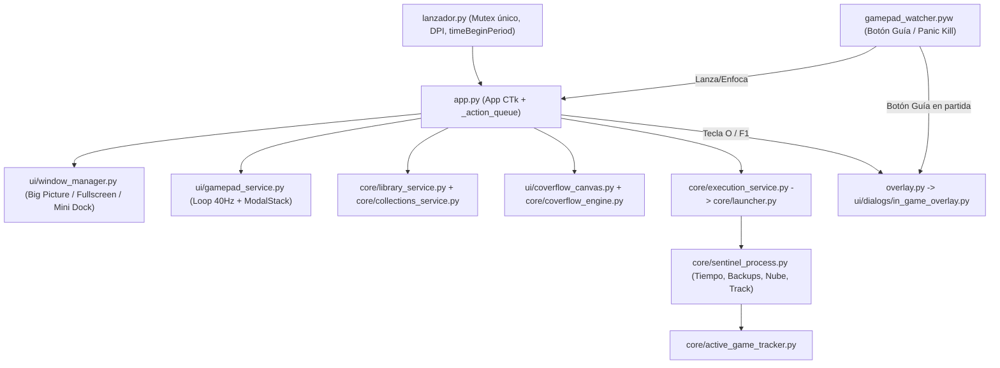

# GameFlow Launcher — Walkthrough Técnico y Guía de Contexto para IA

> **Nota para futuras sesiones de IA / desarrolladores:**  
> Este documento es el mapa maestro de **GameFlow Launcher**. Léelo antes de explorar el código para ahorrar tokens y evitar regresiones.  
> **Regla de mantenimiento:** Cada vez que añadas una funcionalidad, refactorices arquitectura o corrijas un bug relevante, **actualiza la sección afectada y añade una entrada al [Historial de Cambios y Arreglos](#-8-historial-de-cambios-y-arreglos-changelog-vivo)**.

---

## 1. Visión General y Stack

- **Propósito:** Lanzador de videojuegos portable para Windows 10/11 con vista **3D Cover Flow**, modo **Big Picture / Kiosco** y **Mini Dock transparente**, operable **100% con mando** (Xbox XInput, PlayStation DualSense/DS4 HID y genéricos DirectInput/WinMM) sin ratón ni teclado.
- **Stack principal:** Python 3.11+ (`CustomTkinter` + `Tkinter Canvas` + `Pillow` + `psutil` + `ctypes` / `pywin32` en Windows).
- **Soporte Multiplataforma / CI:** La aplicación está enfocada en Windows, pero toda llamada Win32/WMI/COM/XInput debe estar encapsulada o protegida mediante `core/platform_layer.py` (o `getattr(ctypes, "windll", None)`) para ejecutarse y testearse en Linux headless (`xvfb-run`).
- **Directorio raíz:** `app.py`, `lanzador.py`, `overlay.py`, `gamepad_watcher.pyw`, `gamepad_manager.py`, `core/`, `ui/`, `tests/`, `scripts/`, `assets/`.

---

## 2. Arquitectura y Mapa de Módulos



### Puntos de Entrada (Processes & Entrypoints)
| Archivo | Responsabilidad | Detalles Clave |
| :--- | :--- | :--- |
| `lanzador.py` | Arranque principal de la app | Adquiere mutex `Local\GameFlowLauncherAppMutex`, habilita `timeBeginPeriod(1)`, solicita UAC si aplica (`ensure_admin()`) y lanza `App`. |
| `app.py` | Orquestador de interfaz (`App(ctk.CTk)`) | Posee `self.library`, `self.window_manager`, `self.execution_service`, `self.gamepad_service`, `self._modal_stack` y `self._action_queue`. |
| `overlay.py` | Punto de entrada standalone del Overlay | Crea una raíz `CTk` oculta y abre `InGameOverlayDialog` sobre el juego en ejecución. |
| `gamepad_watcher.pyw` | Demonio silencioso en segundo plano | Mutex `Local\GameFlowSteamOSWatcherMutex`. Detecta botón Guía/PS para invocar/enfocar `lanzador.py` o `overlay.py`, y combo de pánico para matar juegos colgados. |
| `core/sentinel_process.py` | Centinela por partida lanzada | Monitorea el proceso del juego/emulador, registra `active_game.json`, suma tiempo de juego con merge atómico, dispara auto-backups, cloud sync y restauración de perfil energético al salir. |

### Capa `core/` (Lógica de Negocio y Servicios)
| Categoría | Módulos | Responsabilidad |
| :--- | :--- | :--- |
| **Persistencia y Config** | `core/config.py`, `core/logger.py`, `core/library_service.py` | Rutas portables vs `%APPDATA%` (`STORAGE_DIR`), `save_json_atomic()`, lock mutex `Local\GameFlowConfigMutex`, `RotatingFileHandler` (`gameflow.log`), carga/fusión de `games.json`. |
| **Estanterías y Colecciones** | `core/collections_service.py` | Configura canales/estanterías (`collections_config.json`), listas personalizadas, filtros por plataforma/estado y **taxonomía canónica de 10 géneros** (`CANONICAL_GENRES`). |
| **Render 3D y Arte** | `core/coverflow_engine.py`, `core/cover_resolver.py`, `core/cover_downloader.py`, `core/steamgriddb_client.py` | Jewel Case 3D, proyección en perspectiva, composición wallpaper 16:9, extracción de `.ico`/`.exe` Win32, scraper Bing/Steam/GOG/SteamGridDB (filtro estricto `>=1920x1080`). |
| **Ejecución y Emuladores** | `core/execution_service.py`, `core/launcher.py`, `core/emulator_service.py`, `core/external_launchers.py`, `core/scanner.py` | Lanzamiento en hilo con afinidad/prioridad y monitor destino; catálogo de **16 sistemas retro**, limpieza de nombres ROM y construcción de comandos (RetroArch, Dolphin, PCSX2, DuckStation, etc.); importadores Steam/Epic/GOG/carpetas. |
| **Partidas, Nube y Logros** | `core/save_backup_service.py`, `core/cloud_sync_service.py`, `core/stats_service.py`, `core/achievements_service.py`, `core/active_game_tracker.py` | Autodetección de saves y `.zip` con retención (10 backups) + copia pre-restauración; OneDrive/GDrive/Dropbox/WebDAV; métricas 7d/30d y metas (`game_stats.json`); Steam Web/XML + RetroAchievements + caché (`achievements_cache.json`). |
| **Sistema y Hardware** | `core/platform_layer.py`, `core/system.py`, `core/power_service.py`, `core/audio_service.py`, `core/feedback.py`, `core/kiosk_service.py`, `core/gamepad_hid.py`, `gamepad_manager.py` | Abstracción Windows/CI, caché WMI de monitores, planes `powercfg` (Eco/Equilibrado/Turbo) + telemetría batería portátil, volumen maestro COM/Win32, audio WAV + vibración XInput, Modo Kiosco (`HKCU\...\Winlogon\Shell` + `Run` + failsafe `explorer.exe`), decodificación HID DualSense/DS4. |

### Capa `ui/` y `ui/dialogs/` (Interfaz Liquid Glass)
| Módulo | Responsabilidad |
| :--- | :--- |
| `ui/theme.py` | Paleta *Liquid Glass*, fuentes adaptativas y helpers Win32 (`bring_to_front_absolute`, `apply_rounded_window_region`, `scroll_to_widget`). |
| `ui/display_scale.py` | Cálculo de escala DPI / resolución (720p handhelds hasta 4K TVs al 200%). |
| `ui/coverflow_canvas.py` | Lienzo `CoverFlowCanvas`: física con inercia horizontal (`1 - exp(-k*dt)`), animación vertical de cambio de estantería a 60fps (`shelf_offset_y`), HUD Big Picture/Mini, carga asíncrona de texturas e hitboxes. |
| `ui/window_manager.py` | Transiciones entre ventana estándar, Pantalla Completa Big Picture y Mini Dock transparente sin bordes (`COLOR_TRANS_KEY`). |
| `ui/gamepad_service.py` | Bucle de sondeo a **40 Hz**, auto-repetición direccional y despacho prioritario al modal en la cima de la pila. |
| `ui/modal_manager.py` & `ui/dialogs/base_dialog.py` | Gestión centralizada de la pila modal (`register_modal_stack`, `unregister_modal_stack`) y clase base `BaseGlassDialog`. |
| `ui/controller_hud.py` & `ui/dropdowns.py` | Píldoras HUD vectoriales (Xbox/PlayStation dinámicos), cápsula de filtro/estantería y menús flotantes (`FloatingGlassMenu`, `FloatingGlassDropdown`). |
| `ui/dialogs/*` | `AddEditGameDialog`, `SelectGameToEditDialog`, `CoverPickerDialog` (+ `cover_crop_engine.py`), `BatchSteamGridDBDialog`, `ExternalImportDialog`, `ScanResultsDialog`, `CollectionsFilterDialog`, `AchievementsDialog`, `GameStatsDialog`, `SaveBackupDialog`, `CloudSyncDialog`, `PerformanceProfileDialog`, `KioskDialog`, `GamepadConfigDialog`, `ControllerInfoDialog`, `InGameOverlayDialog`, `GlassFolderBrowserDialog`, `GlassMessageBox`, `OnScreenKeyboardDialog`, `ConfirmExitDialog`. |

---

## 3. Flujos Internos Clave

### A. Arranque, Bucle 40 Hz y Cola UI
1. `lanzador.py` asegura instancia única y arranca `App` en `app.py`.
2. `App.__init__` carga `library.load()`, inicializa `refresh_shelves()`, lanza `_start_gamepad_loop()` (cada 25 ms → `GamepadNavigationService.tick()`) y `_poll_action_queue()` (cada 50 ms).
3. Si `gamepad_config["start_in_mini_mode"]` está activo y hay mando conectado, tras 80 ms pasa a Mini Dock (`set_mini_mode()`).
4. Cada 4 s, `_poll_battery_status()` actualiza en segundo plano el estado de batería del mando (XInput + HID DualSense/DS4) y refresca el HUD.

### B. Carruseles Multi-Estantería 2D (`↑ / ↓` y `← / →`)
1. `core/collections_service.get_active_shelves(library.games)` devuelve las estanterías habilitadas en el orden definido en `collections_config.json` (Todos, Favoritos, Recientes, Por Jugar, Plataformas, Géneros canónicos y Listas personalizadas).
2. `App.cycle_shelf(direction)` guarda el índice actual en `_shelf_selected_indices[cur_shelf_id]`, cambia `current_shelf_idx` (solo si `len(active_shelves) > 1`), restaura la posición recordada del canal destino y llama a `cover_stage.set_games(..., transition_direction=direction)`.
3. `CoverFlowCanvas` captura la capa saliente (`_outgoing_covers_layer`) y anima `shelf_offset_y` verticalmente a ~60 fps mientras mantiene el fondo ambiental.
4. En `AddEditGameDialog`, cada juego puede asignarse a listas personalizadas (`game["collections"]`) y su género se normaliza mediante `CANONICAL_GENRES` evitando etiquetas duplicadas.

### C. Lanzamiento de Juego / ROM y Ciclo Post-Partida
1. `ExecutionService.launch(game)` verifica `_is_launching` para evitar dobles arranques, aplica perfil energético por juego (`power_service`), y lanza `core/launcher.launch_game_thread(...)`.
2. Si `game["is_rom"]` es `True`, `core/emulator_service.build_rom_launch_command(...)` resuelve el emulador/core de RetroArch y argumentos.
3. El lanzador delega en `core/sentinel_process.py` (proceso desacoplado):
   - Marca juego activo (`active_game_tracker.py` → `active_game.json`) para que el Overlay muestre su título/batería/perfil.
   - Al cerrarse el juego, calcula la duración exacta, fusiona horas jugadas en `games.json` (`merge_existing_playtime=True`), registra actividad diaria en `game_stats.json`, lanza backup automático `.zip` (`save_backup_service`), sincroniza con la nube si está habilitado (`cloud_sync_service`) y restaura el plan de energía previo.

### D. Descarga de Arte y Wallpapers 16:9
1. `core/cover_resolver.py` resuelve portadas locales (`.ico` / `.png` / extracción PE / fallback procedural) en `COVERS_DIR`.
2. `core/cover_downloader.py` + `core/steamgriddb_client.py` consultan en paralelo Steam Store, GOG Catalog, SteamGridDB y Bing Images.
   - **Regla estricta de wallpapers:** `search_google_web_wallpapers` y `search_wallpaper_candidates` descartan miniaturas y exigen `>= 1920x1080` (aspecto 16:9).
   - **Descarga en lote y 1-clic:** Disponible individualmente en `AddEditGameDialog` (`⚡ Fondo 16:9 Auto`) y masivamente en `BatchSteamGridDBDialog`.

---

## 4. Persistencia, Datos Personales y Seguridad Git

Según `core/config.is_portable_mode()`, si existe el archivo marcador `.portable` o `games.json` junto al ejecutable/script, `STORAGE_DIR` es la carpeta del proyecto; si no, `%APPDATA%/GameFlowLauncher` (o `~/.local/share/GameFlowLauncher` en Linux).

- **Archivos de usuario ignorados por `.gitignore` y bloqueados por `scripts/verify_clean_git.py`:**
  - `games.json`, `games.json.bak` (biblioteca del usuario)
  - `gamepad_config.json`, `collections_config.json`, `emulators_config.json`
  - `game_stats.json`, `achievements_config.json`, `achievements_cache.json`, `cloud_sync.json`
  - `covers/*` (excepto `.gitkeep`), `wallpapers/*` (excepto `.gitkeep`), `save_backups/`, `backups/`, `.cache/`, `*.log`, `*.bak`, `*.tmp`, `*.lnk`, `.portable`
- **Plantilla versionada:** `games.example.json`.

---

## 5. Invariantes Técnicas y Reglas de Desarrollo ("Gotchas")

1. **Seguridad de hilos en Tkinter (`winfo_exists` + `_action_queue`):**
   - CustomTkinter/Tkinter NO es thread-safe. Cualquier trabajo de red, disco o PIL va en `threading.Thread(..., daemon=True)` y actualiza la UI vía `self._action_queue.put(...)` o `widget.after(0, ...)` protegiendo siempre con `if not widget.winfo_exists(): return`.
2. **Descriptores PIL:**
   - Abrir siempre imágenes con `with Image.open(path) as im:` y `.copy()` / `.convert(...)` dentro del bloque `with` para no bloquear archivos en Windows ni filtrar handles.
3. **Contrato de Mando en Todos los Modales:**
   - Todo diálogo nuevo o menú flotante debe implementar `handle_gamepad_input(self, inputs, prev) -> bool`, registrarse en `register_modal_stack(self)` / `BaseGlassDialog` y añadirse al check de `tests/mega_audit_test_suite.py`.
   - En `GamepadNavigationService.tick()`, `_prev_buttons` se actualiza **antes** de despachar al modal activo para evitar rebotes si el modal abre un subdiálogo síncrono (`wait_window()`).
4. **Compatibilidad Windows / Linux / CI:**
   - Nunca llamar `ctypes.windll.*` en tiempo de importación sin verificar `is_windows()` o `getattr(ctypes, "windll", None)`. En pruebas unitarias sobre Linux, usar `@unittest.skipUnless(os.name == "nt", ...)`.
5. **Empaquetado PyInstaller (`gameflow.spec`):**
   - Al crear un módulo nuevo en `core/`, `ui/` o `ui/dialogs/`, **obligatorio** añadirlo en `launcher_hiddenimports` (y en `watcher_hiddenimports` o `sentinel_hiddenimports` si lo usan) en `gameflow.spec`, además de listarlo en `files_to_check` dentro de `tests/mega_audit_test_suite.py`.
6. **Pruebas Herméticas y Aislamiento Tcl/Tk:**
   - Ejecutar múltiples raíces `CTk()`/`Tk()` dentro de un solo proceso provoca `Tcl_AsyncDelete` en Linux/headless. Por eso `tests/run_all_tests.py` corre cada `tests/test_*.py` en su propio subproceso.
   - Los tests que creen portadas, cachés o configs deben redirigir `COVERS_DIR`, `CONFIG_FILE`, `CLOUD_SYNC_CONFIG_FILE`, etc., hacia `tempfile.mkdtemp()` y limpiar en `tearDown` / `tearDownClass`.

---

## 6. Comandos Esenciales de Desarrollo y Verificación

- **Ejecutar toda la suite de pruebas + Mega Auditoría:**
  - Windows: `python tests/run_all_tests.py`
  - Linux / CI headless: `xvfb-run -a /home/antigravity/.venv/bin/python tests/run_all_tests.py`
- **Verificar seguridad Git (antes de cada commit):**
  - `python scripts/verify_clean_git.py`
- **Compilar ejecutable portable (Windows):**
  - `python build.py` (o `build.bat`) → genera `dist/GameFlow Launcher/` y `dist/GameFlow_Launcher_Portable.zip`.
- **Sincronización entorno Jugador ↔ Desarrollo:**
  - `python scripts/sync_to_player.py` / `python scripts/sync_from_player.py` (o `.bat` equivalentes).

---

## 7. Estructura de Pruebas (`tests/`)

- `tests/run_all_tests.py`: Ejecutor principal en subprocesos aislados (**35 suites `test_*.py` + `mega_audit_test_suite.py`**).
- `tests/mega_audit_test_suite.py`: Valida compilación sintáctica de todos los módulos de producción, contratos de mando en modales/menús, Cover Flow 3D, wallpapers 16:9, logger y hardware.
- `tests/test_*.py`: Cobertura modular de servicios (`achievements`, `cloud_sync`, `collections_and_filters`, `decoupled_services`, `dualsense_battery*`, `external_launchers`, `kiosk_and_emulators`, `logger_rotation`, `platform_layer`, `playtime_sync`, `portability`, `power_service`, `save_backup`, `stats_service`, `unit_mocked_core`) y UI/regresiones (`1080p_wallpapers`, `batch_steamgriddb`, `carousel_transition_animation`, `coverflow_cache_perf`, `dual_gamepad`, `edit_dialog_usability`, `glass_modals`, `in_game_overlay`, `live_bugfixes_3`, `live_bugfixes_4`, `massive_library_optimization`, `mega_audit_deep_check`, `modal_stack_perf`, `mode_transition_and_60hz_coverflow`, `multi_shelf_navigation`, `on_screen_keyboard`, `resolution_scaling`, `taskbar_modal_fix`, `zorder_and_mini_rules`).

---

## 8. Historial de Cambios y Arreglos (Changelog Vivo)

> Mantén esta sección actualizada en orden cronológico inverso al completar cada tarea.

- **2026-11-13 (`2832ae8` / CI Fix) — Corrección de bloqueos e intolerancia de red/plataforma en CI (`windows-latest`):**
  - `gamepad_manager.ensure_watcher_running()`: añadido `stdin=subprocess.DEVNULL, stdout=subprocess.DEVNULL, stderr=subprocess.DEVNULL, close_fds=True` para evitar herencia de pipes abiertos con `subprocess.run(..., capture_output=True)` y soporte de la variable de entorno `GAMEFLOW_DISABLE_WATCHER=1` para tests.
  - `core/system._read_wmi_friendly_names_powershell()`: añadido `-NoProfile -NonInteractive`, `stdin=subprocess.DEVNULL` y `timeout=3`.
  - `tests/run_all_tests.py`: configurado `PYTHONIOENCODING=utf-8`, `GAMEFLOW_DISABLE_WATCHER=1`, `unittest -v` y manejo explícito de `subprocess.TimeoutExpired` para reportar logs previos si una suite excede el límite.
  - `tests/test_platform_layer.py`: adaptado para validar tanto los shims `_Win32*Shim` como las exportaciones nativas en `windows-latest` y Linux/macOS.
  - `tests/test_live_bugfixes_3.py`: detenida limpiamente la animación `_gamepad_tick` en `DummyApp` y sustituidas las consultas HTTP reales a Bing en `test_3` por respuestas HTML/JSON mockeadas manteniendo intacta la validación de parsing, relevancia (`_is_candidate_relevant`) y etiquetas HD 1080p.
  - `tests/test_mega_audit_deep_check.py`, `tests/test_taskbar_modal_fix.py`, `tests/test_zorder_and_mini_rules.py`: desactivados `ensure_watcher_running`, `ensure_gamebar_nexus_disabled`, `force_foreground_window` de arranque, `get_monitors`, `_start_gamepad_loop`, `_poll_battery_status` e hilos de escaneo/búsqueda en `setUp`/`tearDown` durante pruebas de UI en Windows.
- **2026-11-13 (`c984c7e`) — Rotación 3D vertical entre estanterías y crossfade de fondo:**
  - Añadidas [`render_vertical_shelf_tilt()`](core/coverflow_engine.py) y [`scale_alpha_mask()`](core/coverflow_engine.py) en `core/coverflow_engine.py` con perspectiva en eje X convergente al centro visual (`center_x_in_crop`), sombreado de profundidad, LUT en C (`mask.point(lut)`) y protección de color clave transparente.
  - Refactorizado `ui/coverflow_canvas.py` (`_compose_shelf_layer`, `_extract_shelf_crops`, `_draw_outgoing_shelf_3d`, `_get_incoming_shelf_crops`, `_blend_transition_bg`, `_present_frame`) para rotar en 3D tanto el carrusel saliente como el entrante con física `k=6.8` y crossfade suave entre fondos/wallpapers.
  - Ampliada la cobertura en `tests/test_carousel_transition_animation.py` (`TestVertical3DRotation`: passthrough plano, tilt arriba/abajo, recorte asimétrico, estantería vacía, modo mini transparente y ritmo de crossfade).
- **2026-11-12 (`b6d5164` / `a7b2536`) — Reorganización de pruebas, limpieza de deuda técnica y Walkthrough IA:**
  - Se creó `WALKTHROUGH.md` (este documento) y se enlazó en `README.md`.
  - Se migraron las 35 suites vigentes y `mega_audit_test_suite.py` de `scratch/` a `tests/`, añadiendo `tests/run_all_tests.py` (subprocesos aislados) y eliminando 8 scripts obsoletos/locales.
  - Se protegió `ctypes.windll` en `gamepad_manager.force_foreground_window()` para compatibilidad multiplataforma.
  - Se repararon tests desfasados (`test_1080p_wallpapers.py`, `test_dualsense_battery.py`, `test_edit_dialog_usability.py`, `test_external_launchers.py`, `test_on_screen_keyboard.py`, `test_mode_transition_and_60hz_coverflow.py`, `test_dual_gamepad.py`, `test_glass_modals.py`) y se aislaron `COVERS_DIR`/`CLOUD_SYNC_CONFIG_FILE` en tests para no ensuciar el workspace.
  - Se actualizaron `.github/workflows/test.yml`, `scripts/verify_clean_git.py`, `tests/mega_audit_test_suite.py` (`files_to_check`) y `README.md`.
- **Reciente (`a6ff3b1`) — Animación vertical de transición entre carruseles:**
  - `CoverFlowCanvas` (`set_games(..., transition_direction=...)`) ahora anima el desplazamiento vertical a 60 fps (`shelf_offset_y`, `_outgoing_covers_layer`) al cambiar de estantería en `App.cycle_shelf()`.
- **Reciente (`0300289`) — Blindaje de descriptores PIL y callbacks Tk:**
  - Uso sistemático de `with Image.open(...)` y guardas `winfo_exists()` en callbacks asíncronos.
- **Reciente (`6cae04b`) — Modo Kiosco, Emuladores/ROMs y Fondos 16:9 Auto:**
  - Añadidos `core/kiosk_service.py`, `ui/dialogs/kiosk_dialog.py`, `core/emulator_service.py` (16 sistemas retro + RetroArch/emuladores standalone) y descarga automática 1-clic de wallpapers 16:9 SteamGridDB.
- **Reciente (`8e47d48`) — Auditoría de integridad y writer atómico:**
  - Resolución de imports/nombres faltantes, actualización de `hiddenimports` en `gameflow.spec` y centralización de `save_json_atomic()`.
- **Reciente (`6e45465`) — Estanterías 2D multi-carrusel y taxonomía canónica:**
  - Implementados `core/collections_service.py` y `ui/dialogs/collections_dialog.py` con navegación `↑ / ↓`, memoria de índice por canal, orden/habilitación personalizada y `CANONICAL_GENRES`.
- **Reciente (`8420be6`, `fc06096`, `20d9a76`, `9f735da`, `0fabf7d`, `f0bc99e`) — Suite completa de consola:**
  - Integración de Logros (`achievements_service.py`), Cloud Save Sync (`cloud_sync_service.py`), Perfiles de Rendimiento Handheld (`power_service.py`), Backups de Partidas (`save_backup_service.py`), Estadísticas y Metas (`stats_service.py`) e In-Game Overlay (`overlay.py`, `in_game_overlay.py`, `active_game_tracker.py`, `audio_service.py`).

### Plantilla para futuras actualizaciones
```markdown
- **YYYY-MM-DD (`<commit>` o WIP) — <Título corto del cambio>:**
  - Qué se añadió/arregló y por qué.
  - Archivos principales modificados (`core/...`, `ui/...`, `tests/...`).
  - Nuevas invariantes, flags o notas de compatibilidad/PyInstaller a tener en cuenta.
```
